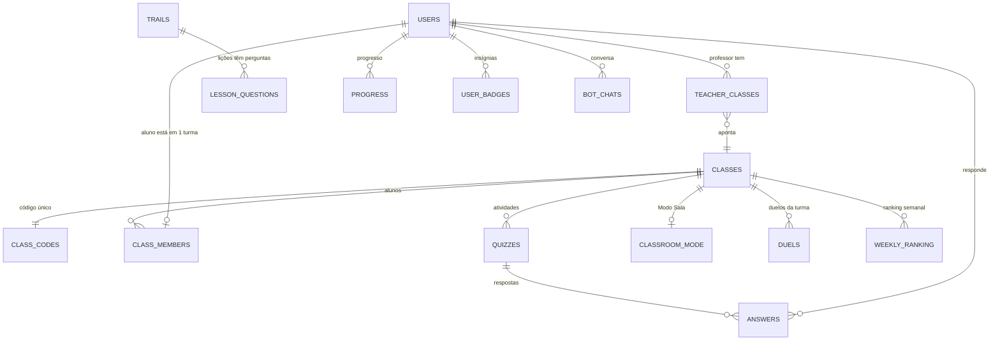

# Práxis Edu: modelagem do banco de dados

> **Firebase Realtime Database (RTDB)** · guia para os devs da equipe
> Stack: React Native (Expo) + Firebase JS SDK (modular) + Firebase Authentication
> Versão 1.0 · outubro/2026

---

## 0. Resumo

- O banco é **uma árvore JSON**. Não existem tabelas, joins ou chaves estrangeiras. A estrutura segue **o que cada tela precisa ler**.
- Os dados ficam **planos** (no máximo 2 ou 3 níveis por nó) e são **duplicados de propósito** quando isso evita leituras extras. Exemplo: o nome do aluno aparece em `classMembers`, `answers` e `weeklyRanking`.
- Toda escrita que mexe em vários nós usa **`update()` multi-path**, que grava tudo ou nada.
- Somas como XP, pontos e contadores usam **`increment()`**. Horários usam **`serverTimestamp()`**, nunca `Date.now()` puro.
- A segurança fica em **`database.rules.json`**: o aluno só vê os próprios dados, e o professor só vê as turmas dele (RNF04).
- **Percentuais e médias não são salvos.** São calculados no app a partir das respostas.

---

## 1. Como o RTDB funciona (diferente de SQL)

| Em SQL você faria | No RTDB fazemos |
|---|---|
| Tabela `turmas` com FK `professor_id` | Nó `classes/{classId}` **e** um índice `teacherClasses/{teacherId}/{classId}: true` |
| `JOIN` aluno ↔ turma | Duplicar o resumo do aluno em `classMembers/{classId}/{uid}` |
| `WHERE codigo = 'BIO101'` | Nó de índice `classCodes/BIO101: classId` (leitura direta, sem query) |
| `SELECT AVG(nota)` | Ler `answers/{classId}` e calcular no app |
| Transação SQL | `update()` multi-path (atômico) ou `runTransaction()` (para um único nó) |
| Permissão no backend | `database.rules.json`, que depende do **caminho** do dado |

Regras de ouro:

1. **Leia só o que a tela mostra.** Ler um nó traz **tudo** que está embaixo dele. Por isso as perguntas das trilhas ficam separadas do mapa da trilha.
2. **O `classId` entra no caminho** de tudo que pertence à turma. Sem isso, a regra de segurança não consegue checar quem é o professor.
3. **Um nó, um dono.** Cada nó tem um responsável na equipe (seção 3).

---

## 2. Convenções

| Item | Padrão | Exemplo |
|---|---|---|
| Nomes de nós e campos | inglês, `camelCase` | `classMembers`, `joinedAt` |
| IDs gerados | `push(ref(...)).key` | `-OaB3kZ9xQ...` |
| ID de usuário | `uid` do Firebase Auth | `aZ81kd...` |
| Datas com hora | número em **ms**, gravado com `serverTimestamp()` | `1760530000000` |
| Dia (para ofensiva) | string `YYYY-MM-DD` no fuso local | `2026-10-15` |
| Semana (para ranking) | string ISO `YYYY-Www` | `2026-W42` |
| Séries | número `1`, `2`, `3` como **valor**; como **chave** use `grade1`, `grade2`, `grade3` | `trails/grade1` |
| Enums | strings em inglês minúsculo | `'teacher'`, `'student'`, `'published'` |
| Arrays | **só** para listas de tamanho fixo: `options` (4) e `picks` | `["Ribossomo", "Mitocôndria", ...]` |
| Listas que crescem | objeto com chave `push()` | `questions: { "-Oa1": {...} }` |
| Booleanos de índice | valor `true` | `teacherClasses/{t}/{c}: true` |

> **Atenção:** nunca use chaves numéricas como `"1"`, `"2"`, `"3"`. O RTDB converte essas chaves em **array** e pode devolver `null` nas posições vazias. Use sempre `grade1`, `q1`, etc.

---

## 3. Mapa da árvore

```
/
├── users/{uid}                              perfil + estatísticas do aluno
├── userBadges/{uid}/{badgeId}               insígnias desbloqueadas
│
├── classes/{classId}                        dados da turma
├── classCodes/{code}                        índice código → classId
├── teacherClasses/{teacherId}/{classId}     índice turmas do professor
├── classMembers/{classId}/{uid}             alunos da turma (resumo)
│
├── trails/{gradeKey}                        mapa da trilha (unidades e lições)
├── lessonQuestions/{lessonId}/{questionId}  perguntas de cada lição
├── progress/{uid}/{lessonId}                progresso do aluno nas lições
│
├── quizzes/{classId}/{quizId}               quizzes/atividades do professor
├── classroomMode/{classId}                  Modo Sala ativo (tempo real)
├── answers/{classId}/{quizId}/{uid}         respostas dos alunos aos quizzes
│
├── duels/{classId}/{duelId}                 duelos 1x1 assíncronos
├── weeklyRanking/{classId}/{weekId}/{uid}   pontos da semana
│
├── botChats/{uid}/{messageId}               histórico do BioBot
└── aiUsage/{uid}/{dateKey}                  limite diário de uso da IA
```

### Dono de cada nó

| Nó | Responsável | RFs | Telas |
|---|---|---|---|
| `users`, `userBadges` (leitura) | **Maria Alice** | RF01, RF02, RF12 | 03, 04, 05, 17, 24, 25 |
| `classes`, `classCodes`, `teacherClasses`, `classMembers` | **João** (entrada por código: Maria Alice) | RF03, RF06 | 06, 07, 08, 18, 19, 25, 33 |
| `trails`, `lessonQuestions`, `progress`, `users/*/stats`, `userBadges` (escrita) | **Maurício** | RF07, RF09 | 11, 12, 26, 27 |
| `duels`, `weeklyRanking` | **Maurício** | RF08, RF09 | 13, 16, 28, 29, 30 |
| `quizzes`, `classroomMode`, `answers` | **Ana Luiza** | RF04, RF05, RF11 | 09, 10, 14, 20, 21, 22, 23, 31 |
| `botChats`, `aiUsage` | **João** | RF10, RF11 | 15, 23 |
| `database.rules.json` | **João** (cada um revisa a parte do seu nó) | RNF04 | n/a |

---

## 4. Diagrama de relacionamentos



**Cardinalidades importantes:**
- Um **professor** tem **N turmas**.
- Um **aluno** está em **no máximo 1 turma** (`users/{uid}/classId`).
- Uma **turma** tem **1 código**, **N alunos**, **N quizzes** e **0 ou 1 Modo Sala ativo**.

---

## 5. Os nós em detalhe

### 5.1 `users/{uid}`

Perfil de qualquer usuário. Os campos de aluno ficam em `stats`. É criado no cadastro.

| Campo | Tipo | Obrigatório | Descrição |
|---|---|---|---|
| `name` | string (2–60) | sim | Nome completo |
| `email` | string | sim | Igual ao do Auth |
| `role` | `'teacher'` \| `'student'` | sim | **Imutável** depois de criado |
| `school` | string | não | Ex.: "EEMTI Rachel de Queiroz" |
| `classId` | string | não | **Só aluno**: turma atual (`null` = ainda não entrou) |
| `createdAt` | timestamp | sim | `serverTimestamp()` |
| `stats.xp` | number | aluno | XP total |
| `stats.streak` | number | aluno | Dias seguidos estudando |
| `stats.bestStreak` | number | aluno | Recorde de ofensiva |
| `stats.lastStudyDate` | `YYYY-MM-DD` | aluno | Último dia com lição concluída |
| `stats.lessonsCompleted` | number | aluno | Lições concluídas (sem repetir) |
| `stats.answersTotal` | number | aluno | Total de questões respondidas |
| `stats.answersCorrect` | number | aluno | Total de acertos |
| `stats.lives` | number (0–5) | aluno | Vidas atuais |
| `stats.livesUpdatedAt` | timestamp | aluno | Base para recarregar vidas |

```json
"users": {
  "uidJiara": {
    "name": "Jiara Martins",
    "email": "jiara@email.com",
    "role": "student",
    "school": "EEMTI Rachel de Queiroz",
    "classId": "-OaClass1A",
    "createdAt": 1760400000000,
    "stats": {
      "xp": 480, "streak": 5, "bestStreak": 7, "lastStudyDate": "2026-10-15",
      "lessonsCompleted": 5, "answersTotal": 50, "answersCorrect": 44,
      "lives": 5, "livesUpdatedAt": 1760530000000
    }
  },
  "uidMauricio": {
    "name": "Maurício Linhares",
    "email": "mauricio@email.com",
    "role": "teacher",
    "school": "EEMTI Rachel de Queiroz",
    "createdAt": 1760300000000
  }
}
```

- **Lê:** o próprio usuário.
- **Escreve:** o próprio usuário.

> O professor **não lê** `users` dos alunos. Ele vê o resumo de cada aluno em `classMembers`.

---

### 5.2 `classes/{classId}`

| Campo | Tipo | Obrigatório | Descrição |
|---|---|---|---|
| `name` | string (2–40) | sim | "1º A – Manhã" |
| `grade` | 1 \| 2 \| 3 | sim | Série |
| `shift` | `'morning'` \| `'afternoon'` \| `'evening'` | sim | Turno |
| `code` | string `AAA000` | sim | Código de entrada, **imutável** |
| `teacherId` | uid | sim | Dono da turma |
| `teacherName` | string | sim | Duplicado para exibir ao aluno |
| `school` | string | não | Duplicado do professor |
| `createdAt` / `updatedAt` | timestamp | sim / não | |

```json
"classes": {
  "-OaClass1A": {
    "name": "1º A – Manhã", "grade": 1, "shift": "morning", "code": "BIO101",
    "teacherId": "uidMauricio", "teacherName": "Prof. Maurício",
    "school": "EEMTI Rachel de Queiroz", "createdAt": 1760300500000
  }
}
```

- **Lê:** o professor dono e os alunos da turma.
- **Cria:** só um usuário com `role = teacher`.
- **Edita e exclui:** só o professor dono.

> Os contadores do card ("28 alunos · 5 quizzes · 78%") **não são salvos**. Eles são calculados a partir de `classMembers`, `quizzes` e `answers` (seção 8).

---

### 5.3 `classCodes/{code}` (índice)

```json
"classCodes": { "BIO101": "-OaClass1A", "BIO204": "-OaClass2A" }
```

- Serve para o aluno digitar `BIO101` e descobrir o `classId` com **uma leitura direta**.
- Formato: 3 letras maiúsculas + 3 dígitos (`/^[A-Z]{3}[0-9]{3}$/`).
- **Lê:** qualquer usuário logado, mas **apenas um código por vez**. Não dá para listar todos.
- **Escreve:** o professor, só ao criar ou excluir a turma dele.

---

### 5.4 `teacherClasses/{teacherId}/{classId}` (índice)

```json
"teacherClasses": { "uidMauricio": { "-OaClass1A": true, "-OaClass2A": true } }
```

- Alimenta a tela **06 Minhas Turmas**.
- **Lê e escreve:** só o próprio professor.

---

### 5.5 `classMembers/{classId}/{uid}`

Resumo do aluno dentro da turma. O professor lê este nó, e nunca `users`.

| Campo | Tipo | Descrição |
|---|---|---|
| `name` | string | Nome do aluno (duplicado) |
| `joinCode` | string | Código usado ao entrar. A regra confere se ele bate com `classes/{classId}/code` |
| `joinedAt` | timestamp | |
| `xp` | number | Espelho de `users/{uid}/stats/xp` |
| `streak` | number | Espelho |
| `lessonsCompleted` | number | Espelho |
| `answersTotal` | number | Espelho |
| `answersCorrect` | number | Espelho. A % de acerto é calculada no app |
| `lastActiveAt` | timestamp | Última atividade |

```json
"classMembers": {
  "-OaClass1A": {
    "uidJiara":  { "name": "Jiara Martins", "joinCode": "BIO101", "joinedAt": 1760400100000,
                   "xp": 480, "streak": 5, "lessonsCompleted": 5, "answersTotal": 50, "answersCorrect": 44,
                   "lastActiveAt": 1760530000000 },
    "uidGabriel":{ "name": "Gabriel Menezes", "joinCode": "BIO101", "joinedAt": 1760400200000,
                   "xp": 240, "streak": 0, "lessonsCompleted": 3, "answersTotal": 30, "answersCorrect": 15,
                   "lastActiveAt": 1760440000000 }
  }
}
```

- **Lê:**
  - o professor dono;
  - os alunos da turma, para o ranking, a escolha de colega no duelo e a tela Minha Turma.
- **Escreve:**
  - o próprio aluno, para entrar, atualizar o resumo e sair;
  - o professor, só para remover aluno.

> A tag **"Precisa de apoio"** é calculada no app: `answersTotal >= 10 && acerto < 60%`.

---

### 5.6 `trails/{gradeKey}`: mapa da trilha (conteúdo fixo)

Guarda só o necessário para desenhar a trilha. As perguntas ficam em `lessonQuestions`.

```json
"trails": {
  "grade1": {
    "title": "1º Ano",
    "units": {
      "u1_cytology": {
        "order": 1, "title": "A Célula como Unidade da Vida", "topic": "cytology", "mascot": "mito",
        "lessons": {
          "g1_cyto_01": { "order": 1, "title": "O que é a célula?", "questionsCount": 5 },
          "g1_cyto_02": { "order": 2, "title": "Membrana plasmática", "questionsCount": 5 },
          "g1_cyto_03": { "order": 3, "title": "Organelas", "questionsCount": 5 }
        }
      },
      "u2_microbiology": {
        "order": 2, "title": "Vírus e Bactérias", "topic": "microbiology", "mascot": "medusa",
        "lessons": { "g1_micro_01": { "order": 1, "title": "Vírus", "questionsCount": 5 } }
      }
    }
  }
}
```

- **Lê:** qualquer usuário logado.
- **Escreve:** ninguém pelo app. O Maurício importa o conteúdo pelo Console do Firebase (Importar JSON).
- **ID da lição:** `g{série}_{tema}_{nº}`, por exemplo `g1_cyto_01`.
- **Desbloqueio:** a lição N fica liberada quando a N−1 está em `progress`. Calculado no app.

---

### 5.7 `lessonQuestions/{lessonId}/{questionId}`

É o **formato padrão de questão**. O mesmo formato é usado em quizzes, Modo Sala, duelos e no gerador de IA.

| Campo | Tipo | Descrição |
|---|---|---|
| `order` | number | Ordem na lição |
| `text` | string | Enunciado |
| `options` | string[4] | Alternativas A–D |
| `answer` | 0–3 | Índice da correta |
| `explanation` | string | Mostrada no feedback (RF04/RF07) |

```json
"lessonQuestions": {
  "g1_cyto_03": {
    "q1": {
      "order": 1,
      "text": "Qual organela realiza a respiração celular?",
      "options": ["Ribossomo", "Mitocôndria", "Complexo de Golgi", "Lisossomo"],
      "answer": 1,
      "explanation": "A mitocôndria produz ATP pela respiração celular: é a usina de energia da célula."
    }
  }
}
```

- **Lê:** qualquer usuário logado.
- **Escreve:** ninguém pelo app (importado pelo Console).

---

### 5.8 `progress/{uid}/{lessonId}`

| Campo | Tipo | Descrição |
|---|---|---|
| `stars` | 0–3 | Melhor resultado |
| `bestCorrect` | number | Melhor nº de acertos |
| `attempts` | number | Quantas vezes jogou |
| `xpEarned` | number | XP total ganho nesta lição |
| `completedAt` | timestamp | Primeira conclusão |
| `lastPlayedAt` | timestamp | |

```json
"progress": { "uidJiara": { "g1_cyto_01": { "stars": 3, "bestCorrect": 5, "attempts": 1, "xpEarned": 75,
                                           "completedAt": 1760450000000, "lastPlayedAt": 1760450000000 } } }
```

- **Lê e escreve:** só o próprio aluno.

---

### 5.9 `userBadges/{uid}/{badgeId}`

O catálogo de insígnias fica **no código** (`src/constants/badges.js`). No banco vai só o que o aluno já desbloqueou.

```json
"userBadges": { "uidJiara": { "cytology_master": { "unlockedAt": 1760450000000 },
                              "born_duelist":    { "unlockedAt": 1760460000000 } } }
```

| `badgeId` | Nome na tela | Como desbloqueia |
|---|---|---|
| `first_lesson` | Primeiro Passo | 1ª lição concluída |
| `cytology_master` | Mestre da Citologia | Todas as lições de Citologia com 3 estrelas |
| `dna_guardian` | Guardião do DNA | Todas as lições de Genética concluídas |
| `born_duelist` | Duelista Nato | 3 duelos vencidos |
| `streak_7` | Semana de Fogo | Ofensiva de 7 dias |
| `classroom_hero` | Destaque da Sala | 100% em um quiz do Modo Sala |

- **Lê e escreve:** só o próprio aluno.

---

### 5.10 `quizzes/{classId}/{quizId}`

| Campo | Tipo | Descrição |
|---|---|---|
| `title` | string | "Quiz 1: A Célula" |
| `topic` | enum de tema (seção 5.16) | Usado no Desempenho por tema |
| `status` | `'draft'` \| `'published'` | O aluno só vê `published` |
| `source` | `'manual'` \| `'ai'` | Se foi gerado pelo Gemini |
| `questionsCount` | number | Duplicado para o card |
| `questions/{questionId}` | formato padrão (5.7) | Chave `push()` |
| `createdBy` | uid | |
| `createdAt` / `updatedAt` | timestamp | |

```json
"quizzes": {
  "-OaClass1A": {
    "-OaQuiz1": {
      "title": "Quiz 1: A Célula", "topic": "cytology", "status": "published", "source": "ai",
      "questionsCount": 3, "createdBy": "uidMauricio", "createdAt": 1760460000000,
      "questions": {
        "-OaQ1": { "order": 1, "text": "Qual organela realiza a respiração celular?",
                   "options": ["Ribossomo", "Mitocôndria", "Complexo de Golgi", "Lisossomo"],
                   "answer": 1, "explanation": "A mitocôndria produz ATP." },
        "-OaQ2": { "order": 2, "text": "A membrana celular tem modelo de:",
                   "options": ["Mosaico fluido", "Bicamada rígida", "Parede de celulose", "Cápsula proteica"],
                   "answer": 0, "explanation": "Lipídios e proteínas se movimentam: mosaico fluido." }
      }
    }
  }
}
```

- **Lê:** o professor dono e os alunos da turma.
- **Escreve:** só o professor dono.

> **Editar um quiz que já tem respostas:** o app permite mudar só o título. Para mudar as questões, é preciso duplicar o quiz, senão os resultados ficam inconsistentes.

---

### 5.11 `classroomMode/{classId}`: Modo Sala (tempo real)

Existe **no máximo 1 por turma**. Quando o Modo Sala termina, o nó é **removido** ou fica com `active: false`.

| Campo | Tipo | Descrição |
|---|---|---|
| `active` | boolean | |
| `quizId` | string | Precisa existir em `quizzes/{classId}` |
| `quizTitle` | string | Duplicado para o banner |
| `durationMin` | 10 \| 15 \| 20 | |
| `startedAt` | timestamp | `serverTimestamp()` |
| `endsAt` | timestamp | `startedAt + durationMin` (usa o relógio do servidor, seção 6.6) |
| `startedBy` | uid | |

```json
"classroomMode": { "-OaClass1A": { "active": true, "quizId": "-OaQuiz1", "quizTitle": "Quiz 1: A Célula",
                                   "durationMin": 15, "startedAt": 1760530000000, "endsAt": 1760530900000,
                                   "startedBy": "uidMauricio" } }
```

- **Lê:** o professor e os alunos da turma, com `onValue` em tempo real.
- **Escreve:** só o professor dono.

---

### 5.12 `answers/{classId}/{quizId}/{uid}`

| Campo | Tipo | Descrição |
|---|---|---|
| `studentName` | string | Duplicado para a tela de resultados |
| `picks` | number[] | Alternativa escolhida em cada questão, **na ordem de `order`** |
| `correctCount` | number | Acertos |
| `total` | number | Nº de questões |
| `mode` | `'classroom'` \| `'homework'` | `classroom` só é aceito com o Modo Sala ativo e dentro do tempo (validado na regra) |
| `startedAt` / `finishedAt` | timestamp | |

```json
"answers": { "-OaClass1A": { "-OaQuiz1": {
  "uidJiara": { "studentName": "Jiara Martins", "picks": [1, 0, 2], "correctCount": 3, "total": 3,
                "mode": "classroom", "startedAt": 1760530100000, "finishedAt": 1760530400000 }
} } }
```

- **Lê:** o professor da turma (todas as respostas) e o aluno (só a dele).
- **Escreve:** o aluno, **uma única vez** (não dá para refazer).

---

### 5.13 `duels/{classId}/{duelId}`: duelo assíncrono

Fluxo de status:

```
challenger_turn → opponent_turn → finished
                ↘ declined (oponente recusou)
```

O desafiante cria o duelo e já joga. Depois é a vez do oponente ("Seu turno!"). Quando o oponente termina, o app calcula o vencedor.

| Campo | Tipo | Descrição |
|---|---|---|
| `challengerId` / `opponentId` | uid | Os dois precisam ser da turma |
| `topic` | enum de tema | |
| `status` | ver fluxo acima | |
| `questions/{qId}` | formato padrão (5.7) | **5 questões copiadas** de `lessonQuestions`, iguais para os dois |
| `players/{uid}/name` | string | |
| `players/{uid}/score` | 0–5 \| ausente | Ausente = ainda não jogou |
| `players/{uid}/picks` | number[] | |
| `players/{uid}/playedAt` | timestamp | |
| `players/{uid}/rewardClaimed` | boolean | Se já somou os pontos no ranking |
| `winnerId` | uid \| `'draw'` | Definido ao finalizar |
| `createdAt` / `updatedAt` | timestamp | `updatedAt` ordena a lista |

```json
"duels": { "-OaClass1A": { "-OaDuel1": {
  "challengerId": "uidLucas", "opponentId": "uidJiara", "topic": "biochemistry",
  "status": "finished", "winnerId": "uidJiara",
  "createdAt": 1760500000000, "updatedAt": 1760510000000,
  "questions": { "q1": { "order": 1, "text": "...", "options": ["a","b","c","d"], "answer": 2, "explanation": "..." } },
  "players": {
    "uidLucas": { "name": "Lucas Ferreira", "score": 2, "picks": [2,0,1,3,0], "playedAt": 1760500300000, "rewardClaimed": true },
    "uidJiara": { "name": "Jiara Martins", "score": 3, "picks": [2,1,1,3,2], "playedAt": 1760510000000, "rewardClaimed": false }
  }
} } }
```

- **Lê:** os alunos da turma. A tela 13 filtra no app os duelos em que eu participo.
- **Cria:** o desafiante.
- **Altera:** cada jogador mexe só no próprio `players/{uid}`. `status`, `winnerId` e `updatedAt` podem ser alterados pelos dois participantes.
- **Pontos no ranking:** cada jogador soma **os próprios** pontos ao abrir o resultado, e então `rewardClaimed` vira `true`. Assim ninguém escreve no ranking de outra pessoa.

---

### 5.14 `weeklyRanking/{classId}/{weekId}/{uid}`

| Campo | Tipo | Descrição |
|---|---|---|
| `name` | string | Duplicado |
| `points` | number | XP ganho na semana + bônus de duelo |
| `duelsWon` | number | |

```json
"weeklyRanking": { "-OaClass1A": { "2026-W42": {
  "uidLucas":   { "name": "Lucas Ferreira",     "points": 520, "duelsWon": 2 },
  "uidJiara":   { "name": "Jiara Martins",      "points": 480, "duelsWon": 1 },
  "uidBeatriz": { "name": "Beatriz Vasconcelos","points": 390, "duelsWon": 0 }
} } }
```

- **Lê:** o professor e os alunos da turma. A consulta usa `orderByChild('points')` + `limitToLast(50)`.
- **Escreve:** cada aluno só na própria linha.
- **Virada da semana:** não é preciso apagar nada. Uma semana nova é um `weekId` novo, e o contador "Reinicia em 2 dias" é calculado no app.

---

### 5.15 `botChats/{uid}/{messageId}` e `aiUsage/{uid}/{dateKey}`

```json
"botChats": { "uidJiara": {
  "-OaM1": { "role": "model", "text": "Olá Jiara! O que quer revisar de Biologia hoje?", "createdAt": 1760520000000 },
  "-OaM2": { "role": "user",  "text": "O que é mitocôndria?", "createdAt": 1760520010000 },
  "-OaM3": { "role": "model", "text": "É a usina de energia da célula!...", "createdAt": 1760520012000 }
} },
"aiUsage": { "uidJiara": { "2026-10-15": { "chatCount": 12 } },
             "uidMauricio": { "2026-10-15": { "generateCount": 3 } } }
```

- `role` usa os mesmos valores do Gemini (`'user'` \| `'model'`), assim o histórico vai direto na chamada.
- Para dar contexto ao Gemini, envie só as **últimas 20 mensagens** (`limitToLast(20)`).
- Limites diários sugeridos: **aluno 30 mensagens**, **professor 10 gerações**. São controlados com `runTransaction` em `aiUsage`.
- **Lê e escreve:** só o próprio usuário.

---

### 5.16 Enum de temas (`topic`)

Fica em `src/constants/topics.js`. Os mascotes vêm do design system.

| `topic` | Rótulo | Série | Mascote |
|---|---|---|---|
| `cytology` | Citologia | 1 | `mito` |
| `biochemistry` | Bioquímica | 1 | `mito` |
| `microbiology` | Microbiologia | 1 | `medusa` |
| `anatomy` | Anatomia e Fisiologia | 1 | `teco` |
| `zoology` | Zoologia | 2 | `mandu` |
| `botany` | Botânica | 2 | `sapo` |
| `marine_biology` | Biologia Marinha | 2 | `baleia` |
| `genetics` | Genética | 3 | `borbo` |
| `ecology` | Ecologia | 3 | `dinho` |
| `biomes` | Biomas do Brasil | 3 | `guara` |
| `biotechnology` | Biotecnologia | 3 | `abelha` |

---

## 6. Operações: como gravar

Todos os exemplos usam o SDK modular:

```js
// src/services/firebase.js  (João)
import { getDatabase } from 'firebase/database';
export const db = getDatabase(app);
```

```js
import {
  ref, get, set, update, push, remove, onValue, off,
  query, orderByChild, limitToLast, runTransaction,
  serverTimestamp, increment,
} from 'firebase/database';
```

### 6.1 Cadastro (Maria Alice)

```js
export async function createUserProfile(uid, { name, email, role }) {
  const base = { name, email, role, createdAt: serverTimestamp() };
  const studentStats = {
    xp: 0, streak: 0, bestStreak: 0, lastStudyDate: null,
    lessonsCompleted: 0, answersTotal: 0, answersCorrect: 0,
    lives: 5, livesUpdatedAt: serverTimestamp(),
  };
  await set(ref(db, `users/${uid}`), role === 'student' ? { ...base, stats: studentStats } : base);
}
```

**Depois do login:**
- `role === 'teacher'`: vai para Minhas Turmas.
- `role === 'student'` sem `classId`: vai para Entrar na turma (25).
- `role === 'student'` com `classId`: vai para Trilhas (11).

### 6.2 Criar turma (João)

```js
function randomCode() {
  const L = 'ABCDEFGHJKLMNPQRSTUVWXYZ';
  const letters = Array.from({ length: 3 }, () => L[Math.floor(Math.random() * L.length)]).join('');
  return letters + String(Math.floor(Math.random() * 1000)).padStart(3, '0');
}

export async function createClass(teacher, { name, grade, shift }) {
  const classId = push(ref(db, 'classes')).key;
  for (let attempt = 0; attempt < 5; attempt++) {
    const code = randomCode();
    if ((await get(ref(db, `classCodes/${code}`))).exists()) continue;
    try {
      await update(ref(db), {
        [`classes/${classId}`]: {
          name, grade, shift, code,
          teacherId: teacher.uid, teacherName: teacher.name, school: teacher.school ?? null,
          createdAt: serverTimestamp(),
        },
        [`classCodes/${code}`]: classId,
        [`teacherClasses/${teacher.uid}/${classId}`]: true,
      });
      return { classId, code };
    } catch (e) {
      // a regra recusa se outro professor pegou o mesmo código no meio tempo → tenta outro
    }
  }
  throw new Error('CLASS_CODE_UNAVAILABLE');
}
```

### 6.3 Editar e excluir turma (João)

```js
export const updateClass = (classId, { name, grade, shift }) =>
  update(ref(db, `classes/${classId}`), { name, grade, shift, updatedAt: serverTimestamp() });

// Exclusão em cascata: tudo de uma vez (atômico)
export async function deleteClass(teacherId, classId, code) {
  await update(ref(db), {
    [`classes/${classId}`]: null,
    [`classCodes/${code}`]: null,
    [`teacherClasses/${teacherId}/${classId}`]: null,
    [`classMembers/${classId}`]: null,
    [`quizzes/${classId}`]: null,
    [`classroomMode/${classId}`]: null,
    [`answers/${classId}`]: null,
    [`duels/${classId}`]: null,
    [`weeklyRanking/${classId}`]: null,
  });
}
```

> O `users/{aluno}/classId` dos alunos **continua apontando** para a turma apagada, porque o professor não pode escrever no perfil deles. Para tratar isso, ao abrir o app, se a leitura de `classes/{classId}` der `PERMISSION_DENIED` ou não existir, o app grava `users/{uid}/classId = null` e manda o aluno para a tela 25.

### 6.4 Entrar na turma e sair (Maria Alice)

```js
export async function joinClass(user, rawCode) {
  const code = rawCode.trim().toUpperCase();
  const snap = await get(ref(db, `classCodes/${code}`));
  if (!snap.exists()) throw new Error('CLASS_NOT_FOUND');
  const classId = snap.val();
  const s = user.stats;
  await update(ref(db), {
    [`classMembers/${classId}/${user.uid}`]: {
      name: user.name, joinCode: code, joinedAt: serverTimestamp(),
      xp: s.xp, streak: s.streak, lessonsCompleted: s.lessonsCompleted,
      answersTotal: s.answersTotal, answersCorrect: s.answersCorrect,
      lastActiveAt: serverTimestamp(),
    },
    [`users/${user.uid}/classId`]: classId,
  });
  return classId;
}

export const leaveClass = (uid, classId) =>
  update(ref(db), { [`classMembers/${classId}/${uid}`]: null, [`users/${uid}/classId`]: null });
```

### 6.5 Criar, editar e excluir quiz (Ana Luiza)

```js
export async function createQuiz(classId, teacherId, { title, topic, source, questions, publish }) {
  const quizRef = push(ref(db, `quizzes/${classId}`));
  const questionsObj = {};
  questions.forEach((q, i) => {
    questionsObj[push(ref(db)).key] = {
      order: i + 1, text: q.text, options: q.options, answer: q.answer, explanation: q.explanation,
    };
  });
  await set(quizRef, {
    title, topic, source, status: publish ? 'published' : 'draft',
    questionsCount: questions.length, questions: questionsObj,
    createdBy: teacherId, createdAt: serverTimestamp(),
  });
  return quizRef.key;
}

export async function deleteQuiz(classId, quizId, activeQuizIdInClassroom) {
  const updates = {
    [`quizzes/${classId}/${quizId}`]: null,
    [`answers/${classId}/${quizId}`]: null,
  };
  if (activeQuizIdInClassroom === quizId) updates[`classroomMode/${classId}`] = null;
  await update(ref(db), updates);
}
```

**Contrato do Gerador IA:** o Gemini deve devolver **exatamente** o formato padrão:

```json
[{ "text": "...", "options": ["...", "...", "...", "..."], "answer": 0, "explanation": "..." }]
```

O app valida o retorno antes de mostrar na tela 23b: 4 opções, `answer` entre 0 e 3, textos não vazios.

### 6.6 Modo Sala com relógio do servidor (Ana Luiza)

Os celulares dos alunos têm relógios diferentes. Por isso **todo cálculo de tempo usa o offset do servidor**.

```js
// hook compartilhado: src/hooks/useServerTime.js
let offset = 0;
onValue(ref(db, '.info/serverTimeOffset'), (snap) => { offset = snap.val() || 0; });
export const serverNow = () => Date.now() + offset;
```

```js
export const startClassroomMode = (classId, teacherId, quiz, durationMin) =>
  set(ref(db, `classroomMode/${classId}`), {
    active: true, quizId: quiz.id, quizTitle: quiz.title, durationMin,
    startedAt: serverTimestamp(),
    endsAt: serverNow() + durationMin * 60_000,
    startedBy: teacherId,
  });

export const stopClassroomMode = (classId) => remove(ref(db, `classroomMode/${classId}`));

// Aluno (tela 14/31): escuta em tempo real
export function listenClassroomMode(classId, callback) {
  const r = ref(db, `classroomMode/${classId}`);
  const unsubscribe = onValue(r, (snap) => {
    const mode = snap.val();
    callback(mode && mode.active && serverNow() < mode.endsAt ? mode : null);
  });
  return unsubscribe; // chamar no cleanup do useEffect
}
```

### 6.7 Responder quiz (Ana Luiza)

```js
export async function submitQuizAnswers(classId, quizId, student, quiz, picks, mode, startedAt) {
  const ordered = Object.values(quiz.questions).sort((a, b) => a.order - b.order);
  const correctCount = ordered.filter((q, i) => picks[i] === q.answer).length;
  await set(ref(db, `answers/${classId}/${quizId}/${student.uid}`), {
    studentName: student.name, picks, correctCount, total: ordered.length,
    mode, startedAt, finishedAt: serverTimestamp(),
  });
  return correctCount;
}
```

> Uma segunda tentativa retorna `PERMISSION_DENIED`, porque a regra só aceita a primeira gravação. Trate esse erro mostrando "Você já respondeu esta atividade".

### 6.8 Concluir lição: XP, ofensiva e ranking (Maurício)

```js
// src/constants/gamification.js
export const XP_PER_CORRECT = 15;
export const XP_PER_CORRECT_REPLAY = 5;
export const MAX_LIVES = 5;
export const LIFE_REFILL_MS = 30 * 60_000;
export const DUEL_POINTS = { win: 30, draw: 15, loss: 5 };
```

```js
export async function completeLesson({ user, lessonId, correct, total, previous }) {
  const isReplay = !!previous;
  const xp = correct * (isReplay ? XP_PER_CORRECT_REPLAY : XP_PER_CORRECT);
  const ratio = correct / total;
  const stars = ratio === 1 ? 3 : ratio >= 0.7 ? 2 : 1;
  const today = toDateKey(new Date());
  const yesterday = toDateKey(new Date(Date.now() - 86_400_000));
  const s = user.stats;
  const streak = s.lastStudyDate === today ? s.streak : s.lastStudyDate === yesterday ? s.streak + 1 : 1;
  const weekId = getWeekId();
  const { uid, classId } = user;

  const updates = {
    [`progress/${uid}/${lessonId}`]: {
      stars: Math.max(stars, previous?.stars ?? 0),
      bestCorrect: Math.max(correct, previous?.bestCorrect ?? 0),
      attempts: (previous?.attempts ?? 0) + 1,
      xpEarned: (previous?.xpEarned ?? 0) + xp,
      completedAt: previous?.completedAt ?? serverTimestamp(),
      lastPlayedAt: serverTimestamp(),
    },
    [`users/${uid}/stats/xp`]: increment(xp),
    [`users/${uid}/stats/answersTotal`]: increment(total),
    [`users/${uid}/stats/answersCorrect`]: increment(correct),
    [`users/${uid}/stats/lessonsCompleted`]: increment(isReplay ? 0 : 1),
    [`users/${uid}/stats/streak`]: streak,
    [`users/${uid}/stats/bestStreak`]: Math.max(streak, s.bestStreak),
    [`users/${uid}/stats/lastStudyDate`]: today,
  };

  if (classId) {
    Object.assign(updates, {
      [`classMembers/${classId}/${uid}/xp`]: increment(xp),
      [`classMembers/${classId}/${uid}/answersTotal`]: increment(total),
      [`classMembers/${classId}/${uid}/answersCorrect`]: increment(correct),
      [`classMembers/${classId}/${uid}/lessonsCompleted`]: increment(isReplay ? 0 : 1),
      [`classMembers/${classId}/${uid}/streak`]: streak,
      [`classMembers/${classId}/${uid}/lastActiveAt`]: serverTimestamp(),
      [`weeklyRanking/${classId}/${weekId}/${uid}/name`]: user.name,
      [`weeklyRanking/${classId}/${weekId}/${uid}/points`]: increment(xp),
    });
  }
  await update(ref(db), updates);
  return { xp, stars, streak };
}
```

**Vidas:** são recarregadas por tempo e calculadas no app. Ao errar uma questão, grave `lives = current - 1` e `livesUpdatedAt = serverTimestamp()`.

```js
export function currentLives({ lives, livesUpdatedAt }, now = serverNow()) {
  if (lives >= MAX_LIVES) return MAX_LIVES;
  return Math.min(MAX_LIVES, lives + Math.floor((now - livesUpdatedAt) / LIFE_REFILL_MS));
}
```

### 6.9 Duelo (Maurício)

```js
export async function createDuel(classId, me, opponent, topic, questions /* 5, formato padrão */) {
  const duelRef = push(ref(db, `duels/${classId}`));
  const qs = {};
  questions.forEach((q, i) => { qs[`q${i + 1}`] = { ...q, order: i + 1 }; });
  await set(duelRef, {
    challengerId: me.uid, opponentId: opponent.uid, topic,
    status: 'challenger_turn', questions: qs,
    players: { [me.uid]: { name: me.name }, [opponent.uid]: { name: opponent.name } },
    createdAt: serverTimestamp(), updatedAt: serverTimestamp(),
  });
  return duelRef.key;
}

// Chamado quando o jogador termina as 5 perguntas
export async function finishMyTurn(classId, duel, me, picks) {
  const ordered = Object.values(duel.questions).sort((a, b) => a.order - b.order);
  const score = ordered.filter((q, i) => picks[i] === q.answer).length;
  const base = `duels/${classId}/${duel.id}`;
  const updates = {
    [`${base}/players/${me.uid}/score`]: score,
    [`${base}/players/${me.uid}/picks`]: picks,
    [`${base}/players/${me.uid}/playedAt`]: serverTimestamp(),
    [`${base}/updatedAt`]: serverTimestamp(),
  };
  if (me.uid === duel.challengerId) {
    updates[`${base}/status`] = 'opponent_turn';
  } else {
    const other = duel.players[duel.challengerId].score;
    updates[`${base}/status`] = 'finished';
    updates[`${base}/winnerId`] = score > other ? me.uid : score < other ? duel.challengerId : 'draw';
  }
  await update(ref(db), updates);
}

// Cada jogador chama ao abrir o resultado (tela 30)
export async function claimDuelReward(classId, duel, me) {
  if (duel.status !== 'finished' || duel.players[me.uid].rewardClaimed) return;
  const result = duel.winnerId === 'draw' ? 'draw' : duel.winnerId === me.uid ? 'win' : 'loss';
  const weekId = getWeekId();
  await update(ref(db), {
    [`duels/${classId}/${duel.id}/players/${me.uid}/rewardClaimed`]: true,
    [`weeklyRanking/${classId}/${weekId}/${me.uid}/name`]: me.name,
    [`weeklyRanking/${classId}/${weekId}/${me.uid}/points`]: increment(DUEL_POINTS[result]),
    [`weeklyRanking/${classId}/${weekId}/${me.uid}/duelsWon`]: increment(result === 'win' ? 1 : 0),
  });
}
```

### 6.10 BioBot com limite diário (João)

```js
export async function consumeAiQuota(uid, field, limit) {
  const r = ref(db, `aiUsage/${uid}/${toDateKey(new Date())}/${field}`);
  const { committed } = await runTransaction(r, (n) => ((n || 0) >= limit ? undefined : (n || 0) + 1));
  if (!committed) throw new Error('AI_DAILY_LIMIT');
}

export const saveChatMessage = (uid, role, text) =>
  push(ref(db, `botChats/${uid}`), { role, text, createdAt: serverTimestamp() });

export const listenChat = (uid, cb) =>
  onValue(query(ref(db, `botChats/${uid}`), orderByChild('createdAt'), limitToLast(50)),
    (snap) => { const list = []; snap.forEach((c) => { list.push({ id: c.key, ...c.val() }); }); cb(list); });
```

### 6.11 Funções utilitárias de data (compartilhadas)

```js
// src/utils/dates.js
export const toDateKey = (d) =>
  `${d.getFullYear()}-${String(d.getMonth() + 1).padStart(2, '0')}-${String(d.getDate()).padStart(2, '0')}`;

export function getWeekId(date = new Date()) {
  const d = new Date(Date.UTC(date.getFullYear(), date.getMonth(), date.getDate()));
  const day = d.getUTCDay() || 7;
  d.setUTCDate(d.getUTCDate() + 4 - day);
  const yearStart = new Date(Date.UTC(d.getUTCFullYear(), 0, 1));
  const week = Math.ceil(((d - yearStart) / 86_400_000 + 1) / 7);
  return `${d.getUTCFullYear()}-W${String(week).padStart(2, '0')}`;
}
```

---

## 7. O que cada tela lê

`get` = leitura única. `onValue` = escuta em tempo real (lembre de cancelar no cleanup).

| Tela | Responsável | Leitura | Tipo |
|---|---|---|---|
| 03/04 Login, Cadastro | Maria Alice | `users/{uid}` após o Auth | get |
| 25 Entrar na turma | Maria Alice | `classCodes/{code}` | get |
| 17 Perfil & Badges | Maria Alice | `users/{uid}`, `userBadges/{uid}`, `classes/{classId}` | onValue |
| 24 Perfil Professor | Maria Alice | `users/{uid}`, `teacherClasses/{uid}` | get |
| 06 Minhas Turmas | João | `teacherClasses/{uid}` e, para cada turma, `classes/{id}`, `classMembers/{id}`, `quizzes/{id}`, `answers/{id}` | onValue |
| 07 Criar/Editar Turma | João | `classes/{id}` (edição) | get |
| 08 Alunos | João | `classMembers/{classId}` | onValue |
| 19 Desempenho | João | `quizzes/{classId}` + `answers/{classId}` + `classMembers/{classId}` | get |
| 33 Minha Turma | João | `classes/{classId}` + `classMembers/{classId}` | onValue |
| 15 BioBot | João | `botChats/{uid}` (`limitToLast(50)`) | onValue |
| 09 Atividades | Ana Luiza | `quizzes/{classId}`, `classroomMode/{classId}`, `answers/{classId}` | onValue |
| 10/23 Criar Quiz / IA | Ana Luiza | `quizzes/{classId}/{quizId}` (edição) | get |
| 20 Resultados | Ana Luiza | `quizzes/{classId}/{quizId}` + `answers/{classId}/{quizId}` | onValue |
| 14/31 Modo Sala (aluno) | Ana Luiza | `classroomMode/{classId}` + `quizzes/{classId}/{quizId}` | onValue |
| 11 Trilhas | Maurício | `trails/grade{n}` + `progress/{uid}` + `users/{uid}/stats` | onValue |
| 12 Lição | Maurício | `lessonQuestions/{lessonId}` | get |
| 13 Duelos | Maurício | `duels/{classId}` (`orderByChild('updatedAt')`) | onValue |
| 28 Escolher colega | Maurício | `classMembers/{classId}` | get |
| 29/30 Partida/Resultado | Maurício | `duels/{classId}/{duelId}` | onValue |
| 16 Ranking | Maurício | `weeklyRanking/{classId}/{weekId}` (`orderByChild('points')`, `limitToLast(50)`) | onValue |

---

## 8. Métricas calculadas no app (não são salvas)

```js
// src/utils/metrics.js
export const accuracy = (correct, total) => (total ? Math.round((correct / total) * 100) : 0);

export const needsSupport = (m) => m.answersTotal >= 10 && accuracy(m.answersCorrect, m.answersTotal) < 60;

// Card da turma (06): % de acertos nos quizzes
export function classAccuracy(answersByQuiz = {}) {
  let c = 0, t = 0;
  Object.values(answersByQuiz).forEach((byStudent) =>
    Object.values(byStudent).forEach((a) => { c += a.correctCount; t += a.total; }));
  return accuracy(c, t);
}

// Desempenho por tema (19)
export function accuracyByTopic(quizzes = {}, answersByQuiz = {}) {
  const acc = {};
  Object.entries(answersByQuiz).forEach(([quizId, byStudent]) => {
    const topic = quizzes[quizId]?.topic;
    if (!topic) return;
    acc[topic] ??= { correct: 0, total: 0 };
    Object.values(byStudent).forEach((a) => { acc[topic].correct += a.correctCount; acc[topic].total += a.total; });
  });
  return Object.entries(acc).map(([topic, v]) => ({ topic, percent: accuracy(v.correct, v.total) }));
}

// Resultados por questão (20)
export function resultsByQuestion(quiz, answers = {}) {
  const ordered = Object.values(quiz.questions).sort((a, b) => a.order - b.order);
  return ordered.map((q, i) => {
    const counts = [0, 0, 0, 0];
    const wrong = [];
    Object.values(answers).forEach((a) => {
      const p = a.picks?.[i];
      if (p != null) counts[p]++;
      if (p !== q.answer) wrong.push(a.studentName);
    });
    const responded = counts.reduce((x, y) => x + y, 0);
    return {
      text: q.text,
      percentCorrect: accuracy(counts[q.answer], responded),
      mostPicked: counts.indexOf(Math.max(...counts)),
      wrongStudents: wrong,
    };
  });
}
```

---

## 9. Regras de segurança: `database.rules.json`

Cole este arquivo em **Console → Realtime Database → Regras**, ou faça deploy com `firebase deploy --only database`.

```json
{
  "rules": {
    "users": {
      "$uid": {
        ".read": "auth != null && auth.uid === $uid",
        ".write": "auth != null && auth.uid === $uid",
        ".validate": "newData.hasChildren(['name', 'email', 'role', 'createdAt'])",
        "name": { ".validate": "newData.isString() && newData.val().length >= 2 && newData.val().length <= 60" },
        "email": { ".validate": "newData.isString()" },
        "role": { ".validate": "(newData.val() === 'teacher' || newData.val() === 'student') && (!data.exists() || data.val() === newData.val())" },
        "classId": { ".validate": "newData.isString()" },
        "stats": {
          "xp": { ".validate": "newData.isNumber() && newData.val() >= 0" },
          "lives": { ".validate": "newData.isNumber() && newData.val() >= 0 && newData.val() <= 5" }
        }
      }
    },

    "userBadges": {
      "$uid": {
        ".read": "auth != null && auth.uid === $uid",
        ".write": "auth != null && auth.uid === $uid",
        "$badgeId": { ".validate": "newData.hasChild('unlockedAt')" }
      }
    },

    "classes": {
      "$classId": {
        ".read": "auth != null && (data.child('teacherId').val() === auth.uid || root.child('classMembers/' + $classId + '/' + auth.uid).exists())",
        ".write": "auth != null && ((data.exists() && data.child('teacherId').val() === auth.uid) || (!data.exists() && newData.child('teacherId').val() === auth.uid && root.child('users/' + auth.uid + '/role').val() === 'teacher'))",
        ".validate": "newData.hasChildren(['name', 'grade', 'shift', 'code', 'teacherId', 'createdAt'])",
        "name": { ".validate": "newData.isString() && newData.val().length >= 2 && newData.val().length <= 40" },
        "grade": { ".validate": "newData.isNumber() && newData.val() >= 1 && newData.val() <= 3" },
        "shift": { ".validate": "newData.val() === 'morning' || newData.val() === 'afternoon' || newData.val() === 'evening'" },
        "code": { ".validate": "newData.isString() && (!data.exists() || data.val() === newData.val())" },
        "teacherId": { ".validate": "newData.val() === auth.uid" }
      }
    },

    "classCodes": {
      "$code": {
        ".read": "auth != null",
        ".write": "auth != null && ((!data.exists() && newData.parent().parent().child('classes/' + newData.val() + '/teacherId').val() === auth.uid) || (!newData.exists() && root.child('classes/' + data.val() + '/teacherId').val() === auth.uid))",
        ".validate": "newData.isString() && $code.matches(/^[A-Z]{3}[0-9]{3}$/)"
      }
    },

    "teacherClasses": {
      "$teacherId": {
        ".read": "auth != null && auth.uid === $teacherId",
        ".write": "auth != null && auth.uid === $teacherId",
        "$classId": { ".validate": "newData.val() === true" }
      }
    },

    "classMembers": {
      "$classId": {
        ".read": "auth != null && (root.child('classes/' + $classId + '/teacherId').val() === auth.uid || data.child(auth.uid).exists())",
        ".write": "auth != null && !newData.exists() && root.child('classes/' + $classId + '/teacherId').val() === auth.uid",
        ".indexOn": ["xp"],
        "$uid": {
          ".write": "auth != null && (auth.uid === $uid || (!newData.exists() && root.child('classes/' + $classId + '/teacherId').val() === auth.uid))",
          ".validate": "newData.hasChildren(['name', 'joinCode', 'joinedAt']) && newData.child('joinCode').val() === root.child('classes/' + $classId + '/code').val()",
          "xp": { ".validate": "newData.isNumber() && newData.val() >= 0" }
        }
      }
    },

    "trails": { ".read": "auth != null" },
    "lessonQuestions": { ".read": "auth != null" },

    "progress": {
      "$uid": {
        ".read": "auth != null && auth.uid === $uid",
        ".write": "auth != null && auth.uid === $uid",
        "$lessonId": {
          "stars": { ".validate": "newData.isNumber() && newData.val() >= 0 && newData.val() <= 3" }
        }
      }
    },

    "quizzes": {
      "$classId": {
        ".read": "auth != null && (root.child('classes/' + $classId + '/teacherId').val() === auth.uid || root.child('classMembers/' + $classId + '/' + auth.uid).exists())",
        ".write": "auth != null && root.child('classes/' + $classId + '/teacherId').val() === auth.uid",
        "$quizId": {
          ".validate": "newData.hasChildren(['title', 'topic', 'status', 'source', 'questions', 'createdAt'])",
          "title": { ".validate": "newData.isString() && newData.val().length >= 2 && newData.val().length <= 80" },
          "status": { ".validate": "newData.val() === 'draft' || newData.val() === 'published'" },
          "source": { ".validate": "newData.val() === 'manual' || newData.val() === 'ai'" },
          "questions": {
            "$questionId": {
              ".validate": "newData.hasChildren(['order', 'text', 'options', 'answer', 'explanation'])",
              "answer": { ".validate": "newData.isNumber() && newData.val() >= 0 && newData.val() <= 3" }
            }
          }
        }
      }
    },

    "classroomMode": {
      "$classId": {
        ".read": "auth != null && (root.child('classes/' + $classId + '/teacherId').val() === auth.uid || root.child('classMembers/' + $classId + '/' + auth.uid).exists())",
        ".write": "auth != null && root.child('classes/' + $classId + '/teacherId').val() === auth.uid",
        ".validate": "newData.hasChildren(['active', 'quizId', 'startedAt', 'endsAt'])",
        "quizId": { ".validate": "root.child('quizzes/' + $classId + '/' + newData.val()).exists()" }
      }
    },

    "answers": {
      "$classId": {
        ".read": "auth != null && root.child('classes/' + $classId + '/teacherId').val() === auth.uid",
        ".write": "auth != null && !newData.exists() && root.child('classes/' + $classId + '/teacherId').val() === auth.uid",
        "$quizId": {
          ".write": "auth != null && !newData.exists() && root.child('classes/' + $classId + '/teacherId').val() === auth.uid",
          "$uid": {
            ".read": "auth != null && auth.uid === $uid",
            ".write": "auth != null && auth.uid === $uid && !data.exists() && root.child('classMembers/' + $classId + '/' + auth.uid).exists() && root.child('quizzes/' + $classId + '/' + $quizId).exists()",
            ".validate": "newData.hasChildren(['studentName', 'picks', 'correctCount', 'total', 'mode', 'finishedAt'])",
            "mode": { ".validate": "newData.val() === 'homework' || (newData.val() === 'classroom' && root.child('classroomMode/' + $classId + '/active').val() === true && root.child('classroomMode/' + $classId + '/quizId').val() === $quizId && now <= root.child('classroomMode/' + $classId + '/endsAt').val() + 30000)" }
          }
        }
      }
    },

    "duels": {
      "$classId": {
        ".read": "auth != null && root.child('classMembers/' + $classId + '/' + auth.uid).exists()",
        ".write": "auth != null && !newData.exists() && root.child('classes/' + $classId + '/teacherId').val() === auth.uid",
        ".indexOn": ["updatedAt"],
        "$duelId": {
          ".write": "auth != null && !data.exists() && newData.child('challengerId').val() === auth.uid && root.child('classMembers/' + $classId + '/' + auth.uid).exists()",
          ".validate": "newData.hasChildren(['challengerId', 'opponentId', 'topic', 'status', 'questions', 'players', 'createdAt', 'updatedAt']) && newData.child('challengerId').val() !== newData.child('opponentId').val() && root.child('classMembers/' + $classId + '/' + newData.child('opponentId').val()).exists()",
          "status": {
            ".write": "auth != null && (root.child('duels/' + $classId + '/' + $duelId + '/challengerId').val() === auth.uid || root.child('duels/' + $classId + '/' + $duelId + '/opponentId').val() === auth.uid)",
            ".validate": "newData.val() === 'challenger_turn' || newData.val() === 'opponent_turn' || newData.val() === 'finished' || newData.val() === 'declined'"
          },
          "winnerId": {
            ".write": "auth != null && (root.child('duels/' + $classId + '/' + $duelId + '/challengerId').val() === auth.uid || root.child('duels/' + $classId + '/' + $duelId + '/opponentId').val() === auth.uid)"
          },
          "updatedAt": {
            ".write": "auth != null && (root.child('duels/' + $classId + '/' + $duelId + '/challengerId').val() === auth.uid || root.child('duels/' + $classId + '/' + $duelId + '/opponentId').val() === auth.uid)"
          },
          "players": {
            "$playerId": {
              ".write": "auth != null && auth.uid === $playerId && root.child('duels/' + $classId + '/' + $duelId).exists()",
              "score": { ".validate": "newData.isNumber() && newData.val() >= 0 && newData.val() <= 5" }
            }
          }
        }
      }
    },

    "weeklyRanking": {
      "$classId": {
        ".read": "auth != null && (root.child('classes/' + $classId + '/teacherId').val() === auth.uid || root.child('classMembers/' + $classId + '/' + auth.uid).exists())",
        ".write": "auth != null && !newData.exists() && root.child('classes/' + $classId + '/teacherId').val() === auth.uid",
        "$weekId": {
          ".indexOn": ["points"],
          ".validate": "$weekId.matches(/^[0-9]{4}-W[0-9]{2}$/)",
          "$uid": {
            ".write": "auth != null && auth.uid === $uid && root.child('classMembers/' + $classId + '/' + auth.uid).exists()",
            ".validate": "newData.hasChildren(['name', 'points']) && newData.child('points').isNumber()"
          }
        }
      }
    },

    "botChats": {
      "$uid": {
        ".read": "auth != null && auth.uid === $uid",
        ".write": "auth != null && auth.uid === $uid",
        ".indexOn": ["createdAt"],
        "$messageId": {
          ".validate": "newData.hasChildren(['role', 'text', 'createdAt']) && (newData.child('role').val() === 'user' || newData.child('role').val() === 'model') && newData.child('text').isString() && newData.child('text').val().length <= 4000"
        }
      }
    },

    "aiUsage": {
      "$uid": {
        ".read": "auth != null && auth.uid === $uid",
        ".write": "auth != null && auth.uid === $uid"
      }
    }
  }
}
```

### Como ler essas regras

- **O que não é liberado é negado.** Não há `.read`/`.write` na raiz, então tudo começa bloqueado.
- **`.read` e `.write` descem na árvore.** Se um nível pai libera, todos os filhos ficam liberados. Por isso, nos nós pai, o professor só pode **apagar tudo** (`!newData.exists()`), o que é usado na exclusão em cascata.
- **`.validate` não desce e não roda em exclusões.** Ele só confere o formato do dado novo.
- **`root`** é o banco **antes** da escrita. **`newData`** é como o nó fica **depois** dela. `newData.parent()` enxerga outros caminhos da mesma `update()` multi-path, e é assim que `classCodes` confere a turma que está sendo criada no mesmo comando.
- **`now`** é o relógio do servidor. Por isso o Modo Sala não aceita resposta depois do fim (`endsAt` + 30 s de tolerância).

### Testar antes de usar

1. Abra Console → Realtime Database → Regras → **Simulador** ("Rules Playground").
2. Simule cada caso como um usuário autenticado com um `uid` específico:
   - aluno lendo `answers` de outro aluno: **negado**;
   - professor lendo turma de outro professor: **negado**;
   - aluno entrando com código errado: **negado**.

---

## 10. Índices

| Caminho | `.indexOn` | Usado em |
|---|---|---|
| `classMembers/{classId}` | `xp` | Ordenar alunos (08, 28) |
| `duels/{classId}` | `updatedAt` | Lista de duelos (13) |
| `weeklyRanking/{classId}/{weekId}` | `points` | Ranking (16) |
| `botChats/{uid}` | `createdAt` | Histórico do BioBot (15) |

> Se aparecer o aviso `Using an unspecified index` no console do app, falta um `.indexOn` nas regras.

---

## 11. Dados de exemplo (seed)

Para testar sem cadastrar tudo à mão:

1. Crie os usuários no **Authentication**: professor `prof@praxis.dev` e alunos `jiara@praxis.dev`, `lucas@praxis.dev`, `gabriel@praxis.dev`, todos com a senha `biologia123`.
2. Troque os `uid...` do JSON abaixo pelos UIDs reais.
3. Importe pelo Console: Realtime Database → ⋮ → **Importar JSON**. A importação **substitui** o nó escolhido.

```json
{
  "users": {
    "uidProf":  { "name": "Maurício Linhares", "email": "prof@praxis.dev", "role": "teacher", "school": "EEMTI Rachel de Queiroz", "createdAt": 1760300000000 },
    "uidJiara": { "name": "Jiara Martins", "email": "jiara@praxis.dev", "role": "student", "school": "EEMTI Rachel de Queiroz", "classId": "class1A", "createdAt": 1760400000000,
                  "stats": { "xp": 480, "streak": 5, "bestStreak": 7, "lastStudyDate": "2026-10-14", "lessonsCompleted": 5, "answersTotal": 50, "answersCorrect": 44, "lives": 5, "livesUpdatedAt": 1760400000000 } },
    "uidLucas": { "name": "Lucas Ferreira", "email": "lucas@praxis.dev", "role": "student", "classId": "class1A", "createdAt": 1760400000000,
                  "stats": { "xp": 520, "streak": 3, "bestStreak": 4, "lastStudyDate": "2026-10-14", "lessonsCompleted": 6, "answersTotal": 60, "answersCorrect": 50, "lives": 5, "livesUpdatedAt": 1760400000000 } },
    "uidGabriel": { "name": "Gabriel Menezes", "email": "gabriel@praxis.dev", "role": "student", "classId": "class1A", "createdAt": 1760400000000,
                  "stats": { "xp": 240, "streak": 0, "bestStreak": 2, "lastStudyDate": "2026-10-10", "lessonsCompleted": 3, "answersTotal": 30, "answersCorrect": 15, "lives": 3, "livesUpdatedAt": 1760400000000 } }
  },
  "classes": {
    "class1A": { "name": "1º A – Manhã", "grade": 1, "shift": "morning", "code": "BIO101", "teacherId": "uidProf", "teacherName": "Prof. Maurício", "school": "EEMTI Rachel de Queiroz", "createdAt": 1760300500000 },
    "class2A": { "name": "2º A – Tarde", "grade": 2, "shift": "afternoon", "code": "BIO204", "teacherId": "uidProf", "teacherName": "Prof. Maurício", "school": "EEMTI Rachel de Queiroz", "createdAt": 1760300600000 }
  },
  "classCodes": { "BIO101": "class1A", "BIO204": "class2A" },
  "teacherClasses": { "uidProf": { "class1A": true, "class2A": true } },
  "classMembers": {
    "class1A": {
      "uidJiara":   { "name": "Jiara Martins",   "joinCode": "BIO101", "joinedAt": 1760400100000, "xp": 480, "streak": 5, "lessonsCompleted": 5, "answersTotal": 50, "answersCorrect": 44, "lastActiveAt": 1760450000000 },
      "uidLucas":   { "name": "Lucas Ferreira",  "joinCode": "BIO101", "joinedAt": 1760400100000, "xp": 520, "streak": 3, "lessonsCompleted": 6, "answersTotal": 60, "answersCorrect": 50, "lastActiveAt": 1760450000000 },
      "uidGabriel": { "name": "Gabriel Menezes", "joinCode": "BIO101", "joinedAt": 1760400100000, "xp": 240, "streak": 0, "lessonsCompleted": 3, "answersTotal": 30, "answersCorrect": 15, "lastActiveAt": 1760440000000 }
    }
  },
  "trails": {
    "grade1": { "title": "1º Ano", "units": {
      "u1_cytology": { "order": 1, "title": "A Célula como Unidade da Vida", "topic": "cytology", "mascot": "mito", "lessons": {
        "g1_cyto_01": { "order": 1, "title": "O que é a célula?", "questionsCount": 2 },
        "g1_cyto_02": { "order": 2, "title": "Organelas", "questionsCount": 2 } } } } }
  },
  "lessonQuestions": {
    "g1_cyto_01": {
      "q1": { "order": 1, "text": "Qual é a unidade básica da vida?", "options": ["Átomo", "Célula", "Tecido", "Órgão"], "answer": 1, "explanation": "Todos os seres vivos são formados por células." },
      "q2": { "order": 2, "text": "Células sem núcleo definido são chamadas de:", "options": ["Eucariontes", "Procariontes", "Gametas", "Neurônios"], "answer": 1, "explanation": "Procariontes, como as bactérias, não têm carioteca." }
    },
    "g1_cyto_02": {
      "q1": { "order": 1, "text": "Qual organela realiza a respiração celular?", "options": ["Ribossomo", "Mitocôndria", "Complexo de Golgi", "Lisossomo"], "answer": 1, "explanation": "A mitocôndria produz ATP." },
      "q2": { "order": 2, "text": "Onde ocorre a síntese de proteínas?", "options": ["Ribossomo", "Vacúolo", "Centríolo", "Lisossomo"], "answer": 0, "explanation": "Os ribossomos traduzem o RNA mensageiro em proteínas." }
    }
  },
  "quizzes": {
    "class1A": {
      "quiz1": { "title": "Quiz 1: A Célula", "topic": "cytology", "status": "published", "source": "manual", "questionsCount": 2, "createdBy": "uidProf", "createdAt": 1760460000000,
        "questions": {
          "qa": { "order": 1, "text": "Qual organela realiza a respiração celular?", "options": ["Ribossomo", "Mitocôndria", "Complexo de Golgi", "Lisossomo"], "answer": 1, "explanation": "A mitocôndria produz ATP." },
          "qb": { "order": 2, "text": "A membrana celular tem modelo de:", "options": ["Mosaico fluido", "Bicamada rígida", "Parede de celulose", "Cápsula proteica"], "answer": 0, "explanation": "Lipídios e proteínas se movimentam: mosaico fluido." } } }
    }
  },
  "answers": {
    "class1A": { "quiz1": {
      "uidJiara":   { "studentName": "Jiara Martins",   "picks": [1, 0], "correctCount": 2, "total": 2, "mode": "homework", "startedAt": 1760470000000, "finishedAt": 1760470100000 },
      "uidGabriel": { "studentName": "Gabriel Menezes", "picks": [0, 0], "correctCount": 1, "total": 2, "mode": "homework", "startedAt": 1760470000000, "finishedAt": 1760470200000 } } }
  },
  "weeklyRanking": {
    "class1A": { "2026-W42": {
      "uidLucas":   { "name": "Lucas Ferreira",  "points": 520, "duelsWon": 2 },
      "uidJiara":   { "name": "Jiara Martins",   "points": 480, "duelsWon": 1 },
      "uidGabriel": { "name": "Gabriel Menezes", "points": 120, "duelsWon": 0 } } }
  }
}
```

---

## 12. Limitações conhecidas e respostas para a arguição

| Pergunta provável | Resposta |
|---|---|
| Por que Realtime Database e não Firestore? | É o exigido na Etapa 3. Além disso, o **Modo Sala** e os **duelos** precisam de sincronização em tempo real com baixa latência, que é o ponto forte do RTDB. |
| Por que tem dado duplicado? | O RTDB não tem join. A duplicação controlada (nome em `classMembers`, `answers`, `ranking`) evita várias leituras por tela. A consistência é garantida por `update()` multi-path, que é atômico. |
| Como garante que o aluno não vê a nota dos outros? | Pelas regras: `answers/{classId}/{quizId}/{uid}` só é lido pelo próprio `uid` ou pelo professor dono da turma (`classes/{classId}/teacherId`). |
| E se o aluno tentar entrar numa turma sem o código? | A regra de `classMembers` exige que o `joinCode` gravado seja igual a `classes/{classId}/code`. |
| O aluno consegue responder depois do tempo do Modo Sala? | Não. A regra compara `now` (relógio do servidor) com `endsAt`. |
| O aluno consegue ver o gabarito? | **Sim, é uma limitação conhecida.** Sem servidor, a correção acontece no celular, então as respostas certas chegam ao app. A melhoria seria mover a correção e o gabarito para uma **Cloud Function** (plano Blaze). |
| O aluno consegue inflar o próprio XP? | Também é possível, porque ele escreve no próprio `stats`. A mitigação seria uma Cloud Function calculando o XP. Para o escopo acadêmico, as regras já limitam tipos e faixas de valor. |
| Onde fica a chave do Gemini? | O ideal é uma Cloud Function como proxy. Sem o plano Blaze, a chave fica em `.env` (fora do Git), e isso é citado como limitação. |
| Como apaga uma turma sem deixar lixo? | Exclusão em cascata com um único `update()`, gravando `null` em 9 caminhos (seção 6.3). |
| Por que não salvar a % de acerto? | Porque ela deriva de outros dados. Calcular no app evita inconsistência. |

---

## 13. Checklist do dev antes de abrir PR

- [ ] Só usei caminhos e campos **deste documento**. Se precisar de campo novo, avise o grupo e atualize este `.md`.
- [ ] Escritas que tocam mais de um nó usam **`update()` multi-path**.
- [ ] Somas usam **`increment()`** e horários usam **`serverTimestamp()`**.
- [ ] Todo `onValue` é cancelado no cleanup do `useEffect`.
- [ ] Trato os erros `PERMISSION_DENIED`, `CLASS_NOT_FOUND`, `AI_DAILY_LIMIT` e "sem internet" com mensagem amigável.
- [ ] Testei minhas telas **no celular físico**, logado como professor **e** como aluno.
- [ ] Nada de chave de API ou `.env` no Git.
- [ ] Nomes de variáveis, funções e comentários em **inglês**.
